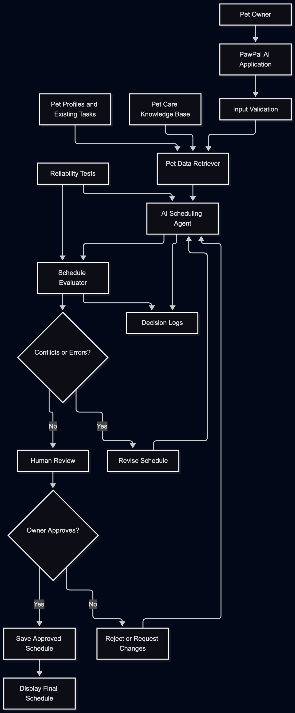

# 🐾 PawPilot AI — Intelligent Pet Care & Scheduling Assistant
**Your pet's care, intelligently guided.**

PawPilot AI is an evolving intelligent pet-care scheduling assistant designed to help busy pet owners organize daily responsibilities, manage multiple pets, identify scheduling conflicts, and make informed care decisions.

This project extends **PawPal+**, originally developed for **CodePath AI110 Module 2**. PawPal+ is a Streamlit application that allows owners to register pets, create care tasks, generate priority-based daily schedules, detect overlapping activities, and manage recurring tasks. Its scheduling logic is implemented in Python and supported by automated tests.

The CodePath final project builds on this foundation with a proposed AI-assisted scheduling workflow that incorporates pet-care knowledge, scheduling recommendations, conflict evaluation, and human review before accepting proposed changes.

The goal is to develop a more intelligent, reliable, and user-centered pet-care assistant while maintaining transparency and owner control over scheduling decisions.

## Scenario: Why PawPilot AI?

Managing daily care for multiple pets can become challenging, especially when feeding schedules, walks, medications, grooming, and other responsibilities compete for limited time.

Pet owners need more than a simple task list. They benefit from a system that can organize responsibilities, recognize scheduling conflicts, consider priorities, and help them make informed decisions.

**PawPilot AI** aims to address these challenges by building on the original PawPal+ scheduling application.

### The Problem

A busy pet owner may need to:
- Manage daily responsibilities for multiple pets.
- Balance high-priority care tasks with limited available time.
- Identify overlapping activities and scheduling conflicts.
- Keep track of recurring tasks such as feeding and medication.
- Understand why certain tasks are recommended or skipped.

### My Approach
The original **PawPal+** application provides task management, priority-based scheduling, recurring tasks, and conflict warnings using Python scheduling logic.

**PawPilot AI** extends this foundation toward an AI-assisted workflow designed to:

- Retrieve relevant pet profiles, existing tasks, and pet-care information.
- Generate scheduling recommendations based on user constraints.
- Evaluate recommendations for conflicts and scheduling errors.
- Allow the owner to review proposed changes before approval.
- Record scheduling decisions to support transparency and testing.

The objective is to combine reliable scheduling logic with AI-assisted recommendations while keeping pet owners in control of final decisions.

## What you will build
PawPilot AI builds on the original PawPal+ application by combining existing pet-care scheduling features with a proposed AI-assisted decision-making workflow.

### Existing Features from PawPal+

The original application already supports:

- Creating and managing pet profiles and care tasks.
- Generating daily schedules based on task priorities and available time.
- Detecting overlapping tasks and displaying conflict warnings.
- Managing recurring daily and weekly tasks.
- Filtering tasks by pet and completion status.
- Displaying schedules through an interactive Streamlit interface.

### Implemented AI Feature: Priority Recommender

- **Machine-learning priority suggestions:** When an owner fills in a task, a small Naive Bayes model trained on synthetic examples suggests `low`, `medium`, or `high` priority, with its confidence and the main reasons.
- **Owner approval or rejection:** The suggestion never changes anything on its own. The owner clicks **Approve** to use it or **Reject** to keep their own choice, and every decision is logged in the app.

See [PawPilot AI Priority Recommender](#pawpilot-ai-priority-recommender) for details and evaluation results.

### Planned AI Enhancements

The other AI features below are still planned and not implemented:

- **Context-Aware Recommendations:** Use pet profiles, existing tasks, and relevant pet-care information to inform scheduling suggestions.
- **AI Scheduling Agent:** Generate recommendations based on priorities, time constraints, and scheduling preferences.
- **Conflict Evaluation:** Check AI-generated recommendations for overlapping tasks and other scheduling issues.
- **Human-in-the-Loop Approval:** Allow pet owners to review and approve or reject proposed scheduling changes.
- **Decision Logging:** Record recommendations and evaluation outcomes to make the workflow easier to understand and debug.
- **Reliability Testing:** Test the AI workflow using realistic scheduling scenarios, including conflicts and invalid inputs.

### Project Objective

My goal is to develop a reliable and understandable AI-assisted scheduling system that helps pet owners organize daily care while keeping them in control of important decisions.

The existing Python scheduling backend provides a foundation for validating and evaluating AI-generated recommendations.

## Getting started

### Setup

**Prerequisites:**
- Python 3.12 or newer
- Git
- A terminal (macOS, Linux, or Windows)

**1. Clone the repository**

```bash
git clone https://github.com/sahithiA1/pawpal-ai-applied-system.git
cd pawpal-ai-applied-system
```

**2. Create a virtual environment**

```bash
python3 -m venv .venv
```

**3. Activate the virtual environment**

For macOS or Linux:

```bash
source .venv/bin/activate
```

For Windows PowerShell:

```powershell
.venv\Scripts\Activate.ps1
```

**4. Install the required dependencies**

```bash
python -m pip install -r requirements.txt
```

**5. Launch the application**

```bash
streamlit run app.py
```

Streamlit will display a local URL, usually `http://localhost:8501`, where you can interact with the application.

**Note:** The app includes the PawPilot AI priority recommender. It uses only Python's standard library and a CSV file in `data/`, so it needs no extra installation, API key, or internet connection. The model is trained when the app starts.

Pets and tasks are kept while the app is open, but they are not saved to a file, so refreshing the page starts over.

### Run the CLI demo

```bash
python3 main.py
```

### Run the tests

```bash
python3 -m pytest
```

See [Testing PawPal+](#testing-pawpal) for details.

### Suggested workflow

These are the steps from the assignment that this project followed:

1. Read the scenario carefully and identify requirements and edge cases.
2. Draft a UML diagram (classes, attributes, methods, relationships).
3. Convert UML into Python class stubs (no logic yet).
4. Implement scheduling logic in small increments.
5. Add tests to verify key behaviors.
6. Connect your logic to the Streamlit UI in `app.py`.
7. Refine UML so it matches what you actually built.

## Using the Streamlit App

The app is one page with four parts.

### Owner & Pets

- Enter the **owner name** and **available minutes today** (starts at 90). The available minutes are the time budget the scheduler fills.
- Add a pet with a **name**, **species** (dog, cat, or other), and **age**. Pet names must be unique; adding a duplicate shows a warning.
- The pets table shows each pet and how many tasks it has.

### Tasks

Choose a pet and fill in the task form:

| Field | Options |
|-------|---------|
| Task title | Any text |
| Duration (minutes) | 1–240 |
| Priority | low, medium, high |
| Category | walk, feeding, meds, grooming, other |
| Preferred time | any, morning, afternoon, evening |
| Repeats | none, daily, weekly |
| Scheduled time | Optional: tick **Set a specific time** and pick a time; otherwise the task has no set time |

New tasks are due today. Adding the same task for the same pet at the same time twice shows a warning instead of creating a duplicate.

Below the form, the **🤖 PawPilot AI priority suggestion** panel suggests a priority for the task you're entering, with its confidence and reasons. Click **Approve** to set the Priority field to the suggestion, or **Reject** to keep your own choice. Each decision is listed under **Suggestion history**. See [PawPilot AI Priority Recommender](#pawpilot-ai-priority-recommender).

### All Tasks

A table of every task with its pet, time, due date, duration, priority, category, preferred time, repeat setting, and status. Three controls change what it shows:

- **Pet:** "All pets" or one pet.
- **Status:** All, Pending, or Completed.
- **Sort by scheduled time:** on by default. Tasks are listed by time, with untimed tasks at the end. When it is off, tasks are listed pet by pet in the order they were added.

If nothing matches the filters, the app says so instead of showing an empty table. The filtering and sorting are done by the backend's `filter_tasks()` and `sort_by_time()` methods.

### Complete a Task

Pick a pending task from the list (each option shows the pet, task, time, and due date) and click **Mark Complete**.

- A one-time task is marked completed.
- A **daily** or **weekly** task is marked completed, and its next occurrence is created automatically. The confirmation message shows the new due date, for example: *"Completed 'Breakfast' for Mochi. It repeats daily, so the next one is due 2026-10-30 at 07:30."*

Completed tasks move to the Completed filter and leave today's schedule. The new occurrence appears as a pending task with its future due date.

### Build Schedule

Click **Generate schedule** to build today's plan. Once generated, the plan stays on the page and updates automatically when you add tasks, complete tasks, or change your available minutes.

- **Summary metrics:** minutes used (for example "55 / 90"), tasks scheduled, and tasks skipped.
- **Today's schedule:** the chosen tasks in time order.
- **Skipped tasks:** tasks that did not fit in the remaining time, or a message that everything fit.
- **Scheduling Conflicts:** one warning for each pair of scheduled tasks whose times overlap, such as *"'Morning walk' (Mochi, 08:00, 30 min) overlaps 'Litter box' (Luna, 08:15) on 2026-10-29"*, or "No scheduling conflicts detected." The app only warns; it does not move or delete tasks.

## Implementation Summary

The core logic lives in `pawpal_system.py` and is built from four classes:

- **Task** is a single care activity, such as a walk, feeding, medication, or grooming. It stores the duration, priority, category, preferred time, an optional scheduled time (`"HH:MM"`), due date, and whether the task repeats. It checks that its scheduled time is valid when it is created, can mark itself complete, and can create its next occurrence (daily or weekly).
- **Pet** holds its own list of tasks. It can add tasks (ignoring duplicates), remove them, and return the ones still pending.
- **Owner** has a name, a daily time budget (`available_minutes`), preferred task categories, and one or more pets.
- **Scheduler** builds the daily plan for one owner. It chooses tasks by priority, preferred category, and time of day, adding them until the owner's available minutes run out, and then displays the chosen tasks in chronological order. It records why each task was scheduled or skipped, warns about overlapping tasks, filters tasks, and adds the next occurrence when a recurring task is completed. See [Smarter Scheduling](#-smarter-scheduling) for details.

The Scheduler does not read tasks from a single pet. It gets them from `Owner.get_all_tasks()`, which combines the tasks of every pet the owner has, so one plan covers all of the owner's pets.

`app.py` keeps the `Owner` in `st.session_state` so pets and tasks survive Streamlit reruns, and creates a fresh `Scheduler` from it whenever it needs one. All scheduling, sorting, filtering, conflict detection, and recurrence logic comes from the backend; the app only collects input and displays results.

The class diagram is in `diagrams/uml.mmd`.

## 📐 Smarter Scheduling

These features are implemented in the `Scheduler` and `Task` classes in `pawpal_system.py`.

| Feature | Method(s) | Notes |
|---------|-----------|-------|
| Task sorting | `Scheduler.sort_by_time()` | Chronological by `"HH:MM"`; tasks without a time go last |
| Filtering | `Scheduler.filter_tasks()` | By pet name, completion status, or both |
| Conflict handling | `Scheduler.detect_conflicts()` | Warns about exact-time and overlapping tasks on the same date |
| Recurring tasks | `Scheduler.complete_task()`, `Task.next_occurrence()` | Daily tasks repeat the next day, weekly tasks seven days later |
| Time validation | `Task.__post_init__()` | Rejects times that are not 24-hour `HH:MM` |

### Sorting tasks by time

`sort_by_time()` returns tasks in chronological order. It converts each time into minutes after midnight before comparing, so `"8:05"` correctly comes before `"20:00"`. Tasks without a scheduled time go at the end. `build_daily_plan()` uses it to display the final plan in time order.

The scheduler still uses the separate `sort_tasks()` method to decide *which* tasks fit in the owner's available time (by priority, preferred category, and time of day). `sort_by_time()` only changes the order in which the chosen tasks are shown.

Limitation: `sort_by_time()` looks only at the clock time, not the due date, so it is meant for a single day's tasks.

### Filtering tasks

`filter_tasks(pet_name=None, completed=None)` returns the owner's tasks across all pets, with optional filters:

```python
scheduler.filter_tasks(pet_name="luna")                    # all of Luna's tasks (case-insensitive)
scheduler.filter_tasks(completed=False)                    # every pending task
scheduler.filter_tasks(pet_name="Mochi", completed=True)   # Mochi's completed tasks
scheduler.filter_tasks()                                   # every task
```

### Recurring tasks

When a task is completed with `scheduler.complete_task(pet, task)`, the task is marked complete. If its `recurrence` is `"daily"` or `"weekly"`, a new incomplete copy is added to the pet:

- A daily task's next occurrence is due one day later. A weekly task's is due seven days later.
- The new task keeps the same title, pet, priority, duration, and scheduled time.
- If the task was overdue, the next date is counted from today, so the new task is not already in the past.
- Completing the same task again does not create a duplicate occurrence.
- Tasks with `recurrence="none"` (the default) do not repeat.
- `complete_task()` only accepts the pet's actual task object. A separate `Task` with the same field values raises a `ValueError`, so a copy can never be marked complete by mistake.

### Conflict warnings

`detect_conflicts()` returns a list of readable warning messages instead of raising errors. It compares every pair of tasks that have a scheduled time and are due on the same date, for the same pet or different pets. Each task takes up the time from its start until its start plus its duration, and two tasks conflict when those time ranges overlap:

- **Exact-time conflict:** two tasks start at the same time, for example both pets' breakfasts at 07:30.
- **Overlapping durations:** one task starts before another one ends, for example a 30-minute walk at 08:00 and a litter box task at 08:15.

A task that starts exactly when another one ends is not a conflict. The scheduler only warns about conflicts. It does not move tasks automatically, so the owner decides how to fix them. Tasks that cross midnight are not checked yet.

### Time validation

A task's `time` must be empty (no scheduled time) or a valid 24-hour time in `HH:MM` format, from `00:00` to `23:59`. Times like `"08:00"`, `"18:30"`, and `"8:05"` are accepted. Invalid times like `"8am"`, `"25:99"`, `"12:60"`, or `"hello"` raise a `ValueError` when the task is created:

```text
ValueError: Invalid time '8am' for task 'Morning walk': time must be in 24-hour HH:MM format (e.g. '08:00' or '18:30').
```

In the Streamlit app, times come from a time picker, so an invalid time cannot be entered there.

### Where each feature is available

| Feature | Backend (`pawpal_system.py`) | CLI demo (`main.py`) | Streamlit app (`app.py`) |
|---------|:---:|:---:|:---:|
| Add pets | ✅ | ✅ | ✅ |
| Add tasks (title, duration, priority) | ✅ | ✅ | ✅ |
| Scheduled time, category, preferred time, recurrence | ✅ | ✅ | ✅ |
| Available minutes | ✅ | ✅ (fixed at 90) | ✅ editable |
| Build the daily plan | ✅ | ✅ | ✅ |
| Sort by time | ✅ | ✅ | ✅ |
| Filter by pet and status | ✅ | ✅ | ✅ |
| Complete tasks and recurrence | ✅ | ✅ | ✅ |
| Conflict warnings | ✅ | ✅ | ✅ |
| Time validation | ✅ | ✅ | ✅ (time picker) |
| Owner preferred categories | ✅ | ✅ | ❌ not editable in the app |
| Edit or delete pets and tasks | ✅ remove methods | ❌ | ❌ |
| Explanation for each scheduled task (`explain_plan()`) | ✅ | ❌ (skipped reasons only) | ❌ |

## 🖥️ CLI Demo

`main.py` runs the backend without the UI. It creates an owner, Jordan, with 90 available minutes and two pets, Mochi and Luna, with eight tasks added out of time order. Two of the tasks are set up to conflict with others.

```bash
python3 main.py
```

The output has four sections: today's schedule (with skipped tasks and conflict warnings), sorting by time, recurring tasks, and filtering. Here are the first and third sections (dates depend on the day you run it):

```text
============================================================
  1. Today's Schedule for Jordan  (2026-10-29)
============================================================
Time   Pet     Task                  Duration  Priority
------------------------------------------------------------
07:30  Mochi   Breakfast             10 min    high
07:30  Luna    Breakfast             10 min    high
08:00  Mochi   Morning walk          30 min    high
08:15  Luna    Litter box            10 min    medium
09:00  Luna    Thyroid medication    5 min     high
16:00  Mochi   Nail trim             15 min    medium
18:00  Luna    Dinner                10 min    medium
------------------------------------------------------------
Time used: 90 of 90 minutes

Skipped tasks:
  - Bath and brush for Mochi (low priority): needs 45 min, but only 0 min were left

Warnings:
  - 'Breakfast' (Mochi) and 'Breakfast' (Luna) are both at 07:30 on 2026-10-29
  - 'Morning walk' (Mochi, 08:00, 30 min) overlaps 'Litter box' (Luna, 08:15) on 2026-10-29

...

============================================================
  3. Recurring tasks
============================================================
Completed Mochi's 'Breakfast' (daily, due 2026-10-29)
  -> next 'Breakfast' due 2026-10-30 at 07:30, completed=False
Completed Mochi's 'Nail trim' (weekly, due 2026-10-29)
  -> next 'Nail trim' due 2026-11-05 at 16:00, completed=False
```

## Testing PawPal+

### Running the tests

On macOS, run the full test suite from the project folder with:

```bash
python3 -m pytest
```

The assignment instructions use `python -m pytest`, which runs the same tests. On many Macs, `python` is not available or points to an older version, so `python3` is the safer choice.

Other useful options:

```bash
# Shorter output (one dot per test):
python3 -m pytest -q

# Run with coverage (requires: pip install pytest-cov):
python3 -m pytest --cov=pawpal_system
```

### Test results

Output from the latest run (the `rootdir` path is shortened to the project folder name for display):

```text
============================= test session starts ==============================
platform darwin -- Python 3.12.7, pytest-7.4.4, pluggy-1.0.0
rootdir: ai110-module2show-pawpal-starter
plugins: anyio-4.2.0
collected 38 items

tests/test_pawpal.py ......................................              [100%]

============================== 38 passed in 0.09s ==============================
```

### What the tests cover

The 38 tests in `tests/test_pawpal.py` cover:

- **Task creation and completion:** marking a task complete and adding a task to a pet.
- **Sorting:** out-of-order times (including `"8:05"` vs `"20:00"`), untimed tasks going last, and leaving the original list unchanged.
- **Filtering:** case-insensitive pet names, completed and pending tasks, both filters combined, an unknown pet name, and no filters.
- **Recurring tasks:** daily and weekly next occurrences, non-recurring tasks, keeping task details, avoiding duplicates, overdue tasks, and rejecting a copied task that is not the pet's actual task.
- **Conflict detection:** exact-time conflicts, overlapping durations for the same pet and for different pets, and cases that should not be flagged (different dates, back-to-back tasks, and tasks without a time).
- **Time validation:** valid times, an empty time, and invalid times.
- **Daily plan (`build_daily_plan()`):**
  - Scheduling priorities: high-priority tasks are kept over low-priority ones.
  - Available-minute limits: the plan never goes over the owner's time, a task that does not fit is skipped while smaller tasks still get scheduled, tasks that exactly fill the time are all scheduled, and an owner with zero minutes gets an empty plan.
  - Empty task lists: an owner with no pets, or a pet with no tasks, gets an empty plan without errors.
  - Task selection: overdue tasks are included, and completed and future tasks are left out.
  - Order: the chosen tasks are listed in time order.

To check that the daily-plan tests are meaningful, each one was also run against deliberately broken versions of the scheduler (for example, one that ignores priority or the time limit), patched in memory only. Every broken version made at least one test fail. The copied-task test was also confirmed to fail against the old version of `complete_task()`.

The Streamlit app was checked during development with Streamlit's `AppTest` tool (adding tasks, generating schedules, conflict warnings, filters, and completing daily and weekly tasks). Those checks are not part of the saved test suite.

### Confidence Level

**★★★★☆ (4/5 stars)**

The backend in `pawpal_system.py` is well tested: every scheduling feature has its own automated tests, including edge cases, and all 38 pass. The Streamlit app is now fully connected to these features and was checked with `AppTest` while it was built. I am not giving it 5 stars because the app has no automated tests in the repository, and a few limitations remain: tasks that cross midnight are not checked for conflicts, `sort_by_time()` ignores the due date, and data is lost when the page is refreshed.

## 📸 Demo Walkthrough

This walkthrough follows one owner from adding a pet to completing a recurring task in the Streamlit app. Start it with `streamlit run app.py`.

1. **Set up the owner.** Enter an owner name, such as Jordan, and keep **Available minutes today** at 90.
2. **Add two pets.** Add Mochi (dog, 3) and then Luna (cat, 5). Both appear in the pets table.
3. **Add a timed, repeating task.** Choose Mochi, enter "Morning walk", 30 minutes, high priority, category walk, preferred time morning, Repeats **daily**. Tick **Set a specific time**, pick 08:00, and click **Add task**.
4. **Add a task that overlaps it.** Choose Luna, enter "Litter box", 10 minutes, medium priority, Repeats none, set the time to 08:15, and add it. It starts while Mochi's walk is still going.
5. **Add an untimed task.** Choose Mochi, enter "Play", 15 minutes, low priority, leave **Set a specific time** unticked, and add it.
6. **Look at All Tasks.** With **Sort by scheduled time** on, the list reads 08:00, 08:15, then Play (no time) at the end. Set **Pet** to Luna to see only her task, then set it back to All pets.
7. **Generate the schedule.** Click **Generate schedule**. The metrics show 55 / 90 minutes used, 3 tasks scheduled, and 0 skipped. Under **Scheduling Conflicts**, a warning says Mochi's 08:00 walk overlaps Luna's 08:15 litter box task.
8. **Try a smaller time budget.** Change **Available minutes today** to 40. The plan updates right away: the low-priority Play task moves to **Skipped tasks**, and the conflict warning is still shown.
9. **Complete the recurring task.** In **Complete a Task**, choose "Mochi – Morning walk (08:00, due …)" and click **Mark Complete**. The message confirms that it repeats daily and shows tomorrow's due date.
10. **Check the results.** In All Tasks, set **Status** to Completed to see today's walk, then Pending to see tomorrow's new walk. In the schedule, the walk is gone from today's plan, so the conflict warning is replaced by "No scheduling conflicts detected."

**Screenshot or video** *(optional)*: <!-- Insert a screenshot or link to a demo video here -->

## PawPilot AI System Architecture

The diagram below illustrates the proposed PawPilot AI workflow, including pet data retrieval, AI scheduling, conflict detection, human approval, and reliability testing.



The editable Mermaid source is available in [diagrams/architecture.mmd](diagrams/architecture.mmd).

## AI Sample Interactions

These are actual outputs from the priority recommender trained on the bundled dataset. None of these titles appear in the training data. They can be reproduced with `model.recommend(...)` from `pawpilot_ml.py`, and the approve/reject flows are covered by `tests/test_app_priority_suggestion.py`.

| Task input (title · category · minutes · species · time) | Suggestion | Confidence | Reasons shown | Comment |
|---|---|---:|---|---|
| Insulin injection · meds · 5 · cat · morning | **high** | 99% | the word 'insulin', the word 'injection', category 'meds' | Correct |
| Walk to the park · walk · 30 · dog · morning | **medium** | 99% | the word 'walk', category 'walk', the word 'park' | Correct |
| Bathe and brush · grooming · 40 · dog · afternoon | **low** | 85% | category 'grooming', long duration, species 'dog' | Correct |
| Treat hot spot on paw · grooming · 10 · dog · any | **low** | 80% | preferred time 'any', category 'grooming', the word 'treat' | ❌ **Wrong.** A hot spot is a skin condition. "Treat" mostly appears in snack examples ("Give a treat") in the training data |
| Zorblax · other · 10 · dog · any | **low** | 65% | preferred time 'any', category 'other', species 'dog' | No title words recognised, so the app shows a "check it carefully" warning |

**Human approval in the app:**

1. **Approve:** The owner enters "Insulin injection" (meds) with priority set to `low`. The app suggests **high**. The owner clicks **Approve**, the priority dropdown changes to `high`, and the history shows *Suggested high → Approved → Priority used: high*.
2. **Reject:** For the same task with priority set to `medium`, the owner clicks **Reject**. The dropdown stays `medium`, and the task is added with `medium` priority.

The wrong "hot spot" suggestion shows why the approval step matters. The model can be confidently wrong, so the owner always makes the final call.

## Design Decisions and Trade-offs

PawPilot AI builds on the original PawPal+ application, which uses a Python scheduling backend and a Streamlit user interface. I chose to extend this existing foundation rather than rebuild the application from scratch because it already provides tested scheduling logic, task management, and conflict detection.

### Key Design Decisions

**1. Separating the backend from the user interface**

I kept the scheduling logic in `pawpal_system.py` and the user interface in `app.py`. This separation makes the system easier to test, maintain, and extend with AI capabilities.

**2. Building on existing scheduling logic**

The original scheduler already considers task priorities, available time, and recurring activities. Reusing this functionality provides a foundation for evaluating future AI-generated scheduling recommendations.

**3. Keeping humans involved in scheduling decisions**

The proposed AI workflow includes an approval checkpoint before accepting recommended schedule changes. This design aims to keep pet owners in control rather than allowing an AI agent to make changes automatically.

**4. Evaluating recommendations for conflicts**

I designed the architecture to evaluate proposed schedules for overlapping activities and scheduling errors. This builds on the existing conflict-detection functionality and provides a way to check AI recommendations before presenting them for approval.

**5. Supporting transparency and testing**

The proposed workflow includes decision logging and reliability testing. These components are intended to help explain scheduling recommendations, identify errors, and evaluate the system's behavior across different scenarios.

### Trade-offs and Limitations

- **Streamlit vs. a custom frontend:** Streamlit makes development and testing faster, but provides less flexibility for complex user interfaces.
- **Existing scheduler vs. a complete redesign:** Reusing the original scheduler reduces implementation complexity, but some limitations remain, including tasks that cross midnight.
- **AI recommendations vs. automatic scheduling changes:** Requiring human approval adds an extra step but helps prevent unwanted schedule modifications.
- **In-memory storage vs. persistent storage:** The existing application keeps data in Streamlit session state rather than a database, making setup simpler but limiting long-term data persistence.
- **AI flexibility vs. predictable behavior:** AI-assisted recommendations may offer greater flexibility than fixed scheduling rules, but require additional validation and testing to establish reliability.

These decisions reflect my goal of developing an understandable and maintainable AI-assisted scheduling system while preserving the functionality already established in PawPal+.

## Testing Summary and Lessons Learned

### Existing Test Results

The original PawPal+ scheduling backend has **38 automated tests**, all of which passed during the latest local test run.

The tests cover:

- Task creation, completion, and validation.
- Daily scheduling based on priority and available time.
- Detection of overlapping and conflicting tasks.
- Daily and weekly recurring tasks.
- Task filtering and chronological sorting.
- Edge cases, including empty schedules and invalid inputs.

The Streamlit interface was also checked during the original project's development using Streamlit's `AppTest` tool.

### What Worked

The existing Python backend successfully generates daily schedules, respects available-time limits, identifies overlapping activities, and handles recurring tasks.

Keeping the scheduling logic separate from the Streamlit interface has also made it easier to test individual components.

### Current Limitations

- Tasks that cross midnight are not currently checked for scheduling conflicts.
- Pet and task data are stored in memory rather than persisted in a database.
- The existing scheduler detects conflicts but does not automatically resolve them.
- Automated Streamlit UI tests cover only the priority-suggestion flow (`tests/test_app_priority_suggestion.py`). The rest of the app is not covered.

### Planned AI Reliability Testing

The priority recommender is now tested (see [PawPilot AI Priority Recommender](#pawpilot-ai-priority-recommender)). For the AI features that are still planned, I intend to evaluate:

- Whether AI recommendations respect scheduling constraints.
- Whether conflicts and invalid recommendations are detected.
- Whether proposed changes require owner approval before being saved.
- How the system handles incomplete information and unusual scheduling requests.
- Whether repeated or similar inputs produce reasonable recommendations.

### Lessons Learned

Building and testing PawPal+ demonstrated the importance of separating application logic from the user interface, validating user input, and testing edge cases.

The PawPilot AI extension will build on these lessons by evaluating how AI-generated recommendations can be combined with deterministic scheduling checks and human oversight.

**Testing status:** The full suite has 297 passing tests and 3 expected failures (known scheduler gaps). This includes 34 AI-specific tests for the priority recommender (29 unit tests and 5 Streamlit app tests). The AI features that are still planned have no tests yet.

## Reliability Evaluation

> **Scope: this section evaluates the existing rule-based PawPal+ scheduler (`pawpal_system.py`). It is not an AI evaluation.** The evaluation of the machine-learning priority recommender is in [PawPilot AI Priority Recommender](#pawpilot-ai-priority-recommender). Other planned AI features (AI scheduling agent, AI conflict review) are not implemented, so there are no results for them.

### Scheduler reliability vs. AI reliability

| | Existing scheduler (rule-based) | AI priority recommender (ML) | Other planned AI features |
|---|---|---|---|
| Implemented? | Yes, in `pawpal_system.py` | Yes, in `pawpilot_ml.py` and `app.py` | No, only planned (see architecture diagram) |
| Tests | `tests/test_pawpal.py` (38) and `tests/test_reliability.py` (228) | `tests/test_priority_recommender.py` (29) and `tests/test_app_priority_suggestion.py` (5) | None |
| Results | 263 passed, 3 known gaps (xfail), 0 unexpected failures | 34 passed. Held-out accuracy 76.7% (23/30) | Not evaluated, nothing to test yet |

### Evaluation results (`tests/test_reliability.py`)

The evaluation runs scenario-level checks on realistic multi-pet days. Known weaknesses are recorded as **strict expected failures** (`xfail(strict=True)`). They are reported as "xfailed" and do not break the run. If one of them is ever fixed, pytest reports it as a failure (XPASS) so this table has to be updated.

| Category | What is checked | Tests | Passed | Known gaps (xfail) | Status |
|---|---|---:|---:|---:|---|
| Valid schedules | Realistic two-pet day is fully scheduled in time order with no conflicts. Rebuilding the plan is deterministic. The explanation covers every task. **200 seeded random scenarios** check that the budget is never exceeded, each task is scheduled or skipped exactly once, and skips are justified. | 203 | 203 | 0 | ✅ Pass |
| Time limits | Being one minute short drops only a low-priority task. A task longer than the whole budget is skipped with a reason. A 24-hour budget fits everything. A negative budget schedules nothing. Duplicate tasks are not counted twice. | 5 | 5 | 0 | ✅ Pass |
| Overlapping tasks | A three-way overlap gives 3 pairwise warnings. Cross-pet clashes appear in the explanation. Skipped tasks are not flagged. Back-to-back tasks don't conflict. A task crossing midnight is detected. | 5 | 4 | 1 | ⚠️ Pass with known gap |
| Invalid input | Malformed times (`" 08:00"`, `"08:00pm"`, `"08-00"`, `"-1:00"`, `"8"`) are rejected and `""` is allowed. A rejected task leaves the plan unchanged. Duplicate pet names are rejected. Removing an unknown pet or task raises an error. Negative durations and unknown priorities are rejected. | 11 | 9 | 2 | ⚠️ Pass with known gaps |
| Empty task lists | Pets with no tasks, all tasks completed, only future tasks, and filtering/sorting empty lists all give empty results without errors. | 4 | 4 | 0 | ✅ Pass |
| **Total (new evaluation)** | | **228** | **225** | **3** | **0 unexpected failures** |

**Scheduler tests only (latest local run, Python 3.14.2, pytest 9.2.0, project `.venv`):**

```text
$ python -m pytest tests/test_pawpal.py tests/test_reliability.py -q
263 passed, 3 xfailed
```

These 263 passing tests are the 38 original backend tests plus the 225 passing evaluation tests. None of them test AI behaviour. With the 34 AI tests included, the full suite is **297 passed, 3 xfailed** (see below).

### Known gaps found by the evaluation

| Gap | Observed behaviour | Impact |
|---|---|---|
| Negative durations accepted | `Task("Bogus", -10)` is accepted. Its −10 minutes are added back to the budget, so a 65-minute task gets scheduled in a 60-minute day. | The time-limit guarantee can be broken by bad input. |
| Unknown priorities accepted | `priority="urgent"` (or a typo) is silently ranked as `medium`. | Tasks can be ranked lower than the owner intended, with no warning. |
| Midnight crossing not checked | A 23:30 task lasting 60 minutes does not conflict with a 00:00 task the next day. | Overnight clashes are missed. |

### How to reproduce

From the project folder, with the project's virtual environment (pytest is installed there, not in the system Python):

```bash
source .venv/bin/activate

# Full suite: original 38 tests + scheduler reliability evaluation + AI recommender tests
python -m pytest -q

# Reliability evaluation only, listing the known gaps
python -m pytest tests/test_reliability.py -q -rxX

# One category at a time, for example overlapping tasks
python -m pytest tests/test_reliability.py -v -k "three_way or across_pets or skipped_task_is_not or back_to_back_tasks_across or midnight"
```

The 200 random scenarios use fixed seeds (`random.Random(seed)` for seeds 0–199), so every run checks the same inputs.

### Limitations of this evaluation

- **No AI is evaluated in this section.** These results are about the rule-based scheduler only. The priority recommender is evaluated separately below, and the AI features that are still planned have no tests.
- **Backend only.** Apart from the priority-suggestion flow, the Streamlit app (`app.py`) is not covered by automated tests. Its input widgets already block some invalid values (for example duration ≥ 1), but nothing tests that automatically.
- **Results depend on today's date.** Tasks default to `date.today()`, so results could in principle differ on a different day or across midnight. No test is known to depend on the specific date.
- **Not covered:** non-integer durations (a string duration raises `TypeError` while the plan is being built, not when the task is created) and `time=None` (accepted at creation). Both were seen during manual checks but are not part of the test suite.
- **Random scenarios check rules, not quality.** They confirm the scheduler's rules always hold, not that the plan is the best possible one. The scheduler is greedy by priority, so it can leave time unused that a different choice of tasks would have filled.

## PawPilot AI Priority Recommender

PawPilot AI's first implemented AI feature is a **machine-learning model that suggests a task's priority**. It is written with Python's standard library only (`csv`, `math`, `random`, `re`, `collections`). It uses no external API, no extra packages, and no internet connection.

### How it works

1. **Training data:** [`data/priority_training_data.csv`](data/priority_training_data.csv) holds **120 synthetic, hand-written example tasks**, 40 each labelled `high`, `medium`, and `low`. The labelling rules and the data's limitations are documented in [`data/README.md`](data/README.md). It is not real user or veterinary data.
2. **Features:** Each task becomes a list of features: the words in its title (lowercased, without common stopwords, plural "s" removed), plus its category, species, preferred time, and a duration bucket (short ≤ 10 min, medium 11–30, long > 30).
3. **Model:** A **multinomial Naive Bayes** classifier with Laplace smoothing (`PriorityRecommender` in [`pawpilot_ml.py`](pawpilot_ml.py)). It learns how often each feature appears with each priority and combines that evidence into a probability for `low`, `medium`, and `high`. Features it has never seen are ignored.
4. **Output:** The suggested priority, its probability (shown as confidence), and up to three features that most favoured it. The output also flags when confidence is below 60%, or when none of the title words were seen in training.
5. **Owner decision:** `review_recommendation()` turns the owner's choice into the priority to use. **Approve** adopts the suggestion, and **Reject** keeps the owner's current choice. The recommender never edits a task by itself.

### In the Streamlit app

Under **Tasks**, the **🤖 PawPilot AI priority suggestion** panel updates as the owner fills in the task form. It shows:

- the suggestion, confidence, and reasons,
- a warning when the title isn't recognised or confidence is low, and a note that this is not veterinary advice,
- **Approve (*priority*)**, which sets the Priority dropdown to the suggestion,
- **Reject (keep my choice)**, which leaves the dropdown unchanged,
- a **Suggestion history** table logging each decision: task, suggestion, confidence, previous choice, decision, and priority used.

The existing scheduler is unchanged. It schedules whatever priority the task ends up with when the owner clicks **Add task**.

### Evaluation results

Measured on the bundled dataset (reproduce with `python -m pawpilot_ml`):

| Measure | Result |
|---|---|
| Held-out test set (fixed stratified split, seed 110: 90 train / 30 test) | **23/30 correct = 76.7%** |
| Majority-class baseline on the same split | 33.3% |
| Leave-one-out accuracy (all 120 examples) | **82/120 = 68.3%** |

Confusion matrix on the held-out split (rows = actual label, columns = prediction):

| actual \ predicted | low | medium | high |
|---|---:|---:|---:|
| **low** | 9 | 1 | 0 |
| **medium** | 3 | 6 | 1 |
| **high** | 1 | 1 | 8 |

The 7 held-out mistakes were: *Agility practice for fun* (low → predicted medium), *Clean ears routine* (medium → low), *Brush teeth* (medium → low), *Change aquarium water* (medium → low), *Refill hay rack* (medium → high), *Monitor breathing after surgery* (high → medium), and *Treat hot spot* (high → low). The last two matter most, because they are health tasks ranked too low.

### AI test results

| Test file | What it checks | Tests | Passed |
|---|---|---:|---:|
| `tests/test_priority_recommender.py` | Training data is balanced and well-formed. Tokenizing and features are correct. Clear unseen tasks get sensible priorities. Probabilities sum to 1. Reasons are given. Training is deterministic. Unrecognised and empty titles are flagged. The measured accuracy above is checked as a regression guard. Invalid durations (`0`, `-10`, `"10"`, `2.5`, `True`) are rejected. An untrained model, empty data, and bad labels are rejected. Unknown categories and species don't crash. Approve adopts the suggestion and Reject keeps the owner's choice. Recommending never changes a task. An approved priority changes what the existing scheduler keeps. | 29 | 29 |
| `tests/test_app_priority_suggestion.py` | Runs the real Streamlit app with `AppTest`: the suggestion is shown without changing the priority. Approve sets the dropdown and logs the decision. Reject keeps the owner's choice, and Add task uses it. The unrecognised-title warning appears. The schedule still generates after an approval. | 5 | 5 |

**Full suite (latest local run, Python 3.14.2, pytest 9.2.0, Streamlit 1.67.0, project `.venv`):** `297 passed, 3 xfailed`. That is 38 original + 225 scheduler reliability + 34 AI tests passing, plus the 3 known scheduler gaps. The result was the same on four repeated runs.

```bash
source .venv/bin/activate
python -m pawpilot_ml                                   # print the model evaluation
python -m pytest tests/test_priority_recommender.py tests/test_app_priority_suggestion.py -v   # AI tests only
python -m pytest -q                                     # everything
```

### Limitations

- **It learns my labels, not ground truth.** Accuracy measures agreement with the hand-written labelling rules in `data/README.md`, not real pet-care urgency.
- **Small dataset.** With 120 examples, a single word can dominate. "Treat" is learned mostly from snack examples, so "Treat hot spot" is ranked low.
- **Confidently wrong is possible.** The hot-spot example scores 80% confidence while being wrong. Confidence comes from the model, not from real-world certainty.
- **Dogs and cats dominate the data.** "Other" pets have few examples, and only English titles are covered.
- **Bag of words.** Word order and negation are ignored ("no medication needed" still contains "medication").
- **Scope.** It only suggests priority. It does not schedule, resolve conflicts, or give veterinary advice. The planned AI scheduling agent and AI conflict review are still not implemented.
- **Testing notes.** The app tests use Streamlit's testing tool, not a real browser. During development, one manual `AppTest` run timed out after 30 seconds while adding a pet. I could not reproduce it in later runs and don't know the cause. The app also uses `use_container_width`, which Streamlit 1.67 reports as deprecated. This was already the case before this change.

## Project Reflection
Developing PawPal+ taught me the importance of breaking complex problems into smaller, manageable components. By separating scheduling logic from the user interface and writing automated tests, I learned how to build a system that is easier to understand, maintain, and improve.

As I extend the project into PawPilot AI, I am exploring how artificial intelligence can support decision-making rather than simply automate tasks. One important design principle is that AI-generated recommendations should be evaluated against clear constraints before they are presented to users.

This project has also helped me recognize that reliable AI systems require more than generating responses. They need validation, meaningful testing, transparency, and human oversight.

My goal with PawPilot AI is to apply these principles to a practical pet-care scheduling assistant while continuing to improve my understanding of AI-assisted software development.